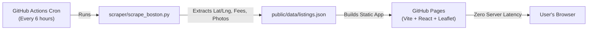

# 🏠 Boston Rentals Hub (Multi-Source Housing Aggregator)

A modern, open-source rental housing aggregator focused on **Boston, MA** that unites listings from **Craigslist, Zillow, and Facebook Marketplace** with:
- 🗺️ **Interactive OpenStreetMap / Leaflet map** with custom price pins
- 🛡️ **Automated Broker Fee Detection** (identifies **"NO BROKER FEE"** vs **"BROKER FEE"**)
- 📸 **High-resolution photo galleries** with instant image carousels
- ⚡ **$0 Server Cost**: Powered by a static flat-file database (`listings.json`), automated by **GitHub Actions**, and hosted on **GitHub Pages**.

---

## 🏛️ System Architecture



1. **Scraping Worker (`scraper/scrape_boston.py`)**:
   - Concurrently scrapes live Boston rental posts from Craigslist.
   - Extracts exact latitude & longitude coordinates.
   - Analyzes title and description text using regex heuristics to classify broker fees (`No Fee`, `Broker Fee`, `Fee Unspecified`).
   - Merges cross-platform listings from Zillow and Facebook Marketplace.
   - Outputs normalized dataset to `public/data/listings.json`.

2. **Frontend UI (`src/`)**:
   - Built with **React + Tailwind CSS + Lucide Icons**.
   - Interactive map rendered with **Leaflet / OpenStreetMap / CartoDB** (no Google Maps API fees).
   - Fast client-side filtering by **Price Slider**, **Broker Fee status**, **Bedrooms**, **Source Platform**, and **Neighborhood search**.

3. **Continuous Deployment (`.github/workflows/scrape_and_deploy.yml`)**:
   - Runs automatically every 6 hours (or manually via workflow dispatch).
   - Refreshes listings, commits the updated `listings.json`, builds the app, and deploys directly to **GitHub Pages**.

---

## 🚀 Quick Start (Local Development)

### 1. Run the Web Application
```bash
# Install dependencies
npm install

# Start local dev server
npm run dev
```
Open [http://localhost:5173](http://localhost:5173) in your browser.

### 2. Run the Boston Scraper Manually
```bash
# Refresh listings from Craigslist Boston
python3 scraper/scrape_boston.py
```
This fetches the latest rental postings, updates photo links and coordinates, and regenerates `public/data/listings.json`.

---

## 🌐 Publishing to GitHub & GitHub Pages

Because the GitHub CLI (`gh`) is installed, you can create the remote repository and push in one step:

```bash
# 1. Create a public GitHub repository under your account
gh repo create boston-housing-aggregator --public --source=. --remote=origin --push

# 2. Enable GitHub Pages in your repository settings:
# Go to: Repository Settings -> Pages
# Set "Build and deployment" Source to: "GitHub Actions"
```

Once pushed, GitHub Actions will:
1. Run the scraper.
2. Build the production site.
3. Publish to `https://<your-username>.github.io/boston-housing-aggregator/`.
4. Keep the site continuously updated every 6 hours automatically!

---

## 📁 Project Structure

```
boston-housing-aggregator/
├── .github/workflows/
│   └── scrape_and_deploy.yml   # Scheduled GitHub Actions cron scraper & deployer
├── scraper/
│   └── scrape_boston.py        # Python scraper for Boston (Craigslist + fee analyzer)
├── public/
│   └── data/
│       ├── listings.json       # Flat-file database of Boston rentals
│       └── metadata.json       # Scraper statistics and timestamp
├── src/
│   ├── components/
│   │   ├── MapView.jsx         # Leaflet interactive map with custom price pins
│   │   ├── ListingCard.jsx     # Apartment card with image carousel & fee badges
│   │   ├── FilterBar.jsx       # Fee toggles, price slider, and search filters
│   │   └── ListingModal.jsx    # Full detail modal
│   ├── App.jsx                 # Split-screen responsive layout
│   ├── main.jsx                # React root
│   └── index.css               # Tailwind & Leaflet styles
├── package.json
└── vite.config.js
```
